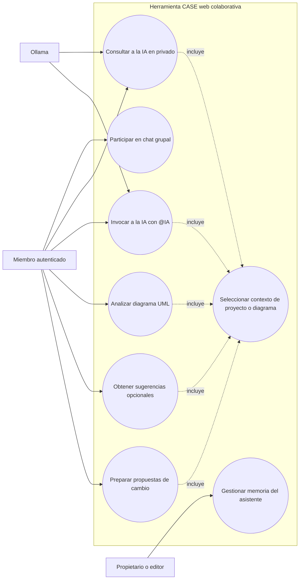
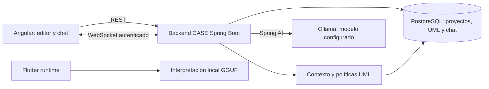

# Segundo Parcial: ampliación de la herramienta CASE colaborativa con asistencia inteligente

## 1. Introducción

Este documento complementa el informe del primer parcial de Ingeniería de
Software I. Mantiene como base la herramienta CASE colaborativa para modelar
diagramas UML de clases, generar software, importar y exportar modelos, y
utilizar una aplicación móvil genérica. La ampliación documentada fortalece la
asistencia inteligente para los integrantes del equipo mediante conversaciones
con contexto del proyecto, análisis UML, sugerencias y propuestas de cambio.

El trabajo se describe con el enfoque dirigido por casos de uso del Proceso
Unificado de Desarrollo de Software (PUDS). Los casos se contrastaron con la
versión actual de los dos repositorios del proyecto: la herramienta CASE web y
el runtime móvil Flutter. Por eso, el documento distingue
las funciones implementadas de los requisitos que todavía no están cubiertos.

## 2. Objetivo de la ampliación

Ampliar la herramienta CASE con un asistente técnico que responda preguntas
sobre el proyecto y oriente al equipo, incorporando conversación grupal con
autor identificado, contexto UML seleccionable, análisis del diagrama,
sugerencias y propuestas revisables. La IA debe operar dentro de los permisos
del proyecto y no alterar el modelo canónico sin validación del sistema.

## 3. Alcance del segundo parcial

La ampliación comprende:

- Chat grupal por proyecto con identidad del autor, persistencia e intercambio
  en tiempo real.
- Conversación privada con la IA por proyecto.
- Contexto seleccionable entre el diagrama actual y el proyecto; memoria
  explícita privada o compartida y referencias de conocimiento UML.
- Respuestas a consultas factuales soportadas a partir de los diagramas
  persistidos.
- Revisión asistida de diagramas UML con hallazgos estructurados.
- Sugerencias opcionales de mejora que no modifican el diagrama.
- Propuestas limitadas para cambios de atributos que el usuario puede revisar,
  editar o descartar.
- Configuración del servidor de IA web mediante Ollama.
- Continuidad de la IA móvil local para interpretar comandos del runtime,
  como capacidad independiente del chat técnico web.

El proveedor externo compatible con Google Colab figura como requisito
pendiente: el chat web revisado integra Ollama y no ofrece un selector de
proveedores ni una conexión a Colab. Tampoco se afirma que el producto esté
completado al 100 %; esta ampliación documenta las funciones que se encontraron
implementadas y sus límites.

## 4. Requisitos funcionales de la ampliación

| ID | Requisito | Criterio observable | Estado revisado |
| --- | --- | --- | --- |
| RF-2P-01 | Conversar con la IA como asistente técnico | El miembro envía una consulta privada o invoca a la IA en el chat grupal y recibe una respuesta asociada a la conversación. | Implementado con Ollama. |
| RF-2P-02 | Contextualizar respuestas | La IA usa el ámbito escogido, datos persistidos del proyecto, historial reciente permitido, memorias y referencias UML pertinentes. | Implementado con límites de contexto. |
| RF-2P-03 | Identificar autores del chat grupal | Los mensajes muestran nombre y hora; la identidad se obtiene desde la autenticación del servidor. | Implementado. |
| RF-2P-04 | Mantener conversaciones privadas y grupales | El chat privado solo es visible para su propietario; el grupal se comparte con miembros autorizados. | Implementado. |
| RF-2P-05 | Administrar memoria contextual | Gestionar recuerdos privados y compartidos con controles de acceso. | Implementado como memoria explícita; no aprende automáticamente de toda la conversación. |
| RF-2P-06 | Analizar diagramas UML | Mostrar resumen y hallazgos por severidad, categoría y elemento, con validaciones contra afirmaciones sin respaldo. | Implementado. |
| RF-2P-07 | Sugerir mejoras | Presentar un máximo de tres recomendaciones opcionales relacionadas con el modelo. | Implementado; no aplica cambios. |
| RF-2P-08 | Preparar propuestas de modificación | Proponer cambios acotados a atributos y permitir revisión, edición o descarte. | Implementado como vista previa; no existe acción para aplicarlas en este flujo. |
| RF-2P-09 | Configurar modelo local | Usar la opción local de IA en el runtime móvil y configurar el Ollama del chat web desde el despliegue del backend. | Opción local implementada en Flutter; Ollama configurable por despliegue. No hay selector unificado por usuario ni proveedor intercambiable en el chat web. |
| RF-2P-10 | Usar un modelo externo compatible con Colab | Conectar un servicio externo sin exponer credenciales al cliente. | Pendiente en el chat web revisado. |

## 5. Actores

| Actor | Responsabilidad en la ampliación |
| --- | --- |
| Miembro del proyecto | Participar en el chat, consultar a la IA, analizar diagramas y revisar sugerencias. Puede tener rol `OWNER`, `EDITOR` o `VIEWER`. |
| Propietario o editor | Además de consultar, puede crear, modificar o eliminar recuerdos compartidos del proyecto. |
| Integrante autenticado | Administrar sus recuerdos privados y acceder a su conversación privada con la IA. |
| Responsable del despliegue | Configurar las variables del servidor y preparar Ollama y el modelo configurado. |
| Proveedor de IA | Generar respuestas para el backend; el chat web actual usa Ollama. |

La identidad y el rol se resuelven en el backend a partir de la autenticación y
la membresía del proyecto. No se acepta como autor o rol un valor declarado por
el cliente.

## 6. Modelo de casos de uso

## 7. Lista y prioridad de los casos de uso nuevos

| ID | Caso de uso | Prioridad | Estado |
| --- | --- | --- | --- |
| CU-01 | Consultar a la IA como asistente técnico y mentor | Alta | Implementado mediante chat contextual con Ollama. |
| CU-02 | Participar en el chat grupal con autor identificado | Alta | Implementado por REST y WebSocket. |
| CU-03 | Invocar a la IA desde el chat grupal | Alta | Implementado mediante `@IA`. |
| CU-04 | Consultar a la IA en una conversación privada | Alta | Implementado con historial persistente privado. |
| CU-05 | Gestionar la memoria técnica del asistente | Media | Implementado como recuerdos explícitos privados o de proyecto. |
| CU-06 | Analizar un diagrama UML y consultar hallazgos | Alta | Implementado en el editor. |
| CU-07 | Obtener sugerencias de mejora opcionales | Media | Implementado; las sugerencias no cambian el modelo. |
| CU-08 | Preparar propuestas de cambio UML | Alta | Implementado como vista previa; no se aplican desde este flujo. |

La interpretación de comandos con IA local pertenece a la línea base del
primer parcial y se mantiene como capacidad heredada, no como caso de uso nuevo.
Está implementada en el segundo repositorio, `sw1-uml-mobile-runtime`, mediante
el binding Android de llama.cpp y un modelo Qwen3-0.6B en formato GGUF. Cuenta
como evidencia de la opción de IA local en el producto compuesto por ambos
repositorios, aunque interpreta comandos CRUD y no responde preguntas técnicas
del chat mentor web.

## 8. Especificación de los casos de uso

### CU-01. Consultar a la IA como asistente técnico y mentor

**Actor principal:** Miembro autenticado del proyecto.  
**Precondiciones:** El usuario inició sesión, pertenece al proyecto y la
conversación está disponible. Para obtener generación, el orquestador debe
estar habilitado y Ollama accesible.

**Flujo principal:**

1. El miembro abre el chat y selecciona `Diagrama actual` o `Proyecto completo`.
2. Elige `Privado con IA` o envía una pregunta que menciona `@IA` en el grupo.
3. El backend valida el acceso y guarda el mensaje con el autor autenticado.
4. El backend construye el contexto con datos persistidos, recuerdos
   autorizados, hasta ocho mensajes recientes y referencias UML aplicables.
5. Ollama genera una respuesta; el backend la guarda como mensaje de IA.
6. La respuesta aparece en el chat privado del usuario o se difunde al grupo.

**Alternativas:** Las consultas factuales soportadas sobre inventario de
diagramas, clases, atributos, métodos o relaciones pueden resolverse
directamente desde los datos persistidos. Si el proveedor falla, el mensaje
humano permanece guardado y el sistema presenta un error controlado.

**Postcondición:** La pregunta y la respuesta, si se genera, forman parte del
historial de la conversación correspondiente.

### CU-02. Participar en el chat grupal con autor identificado

**Actor principal:** Miembro autenticado (`OWNER`, `EDITOR` o `VIEWER`).  
**Flujo principal:** El miembro abre el chat; el cliente carga el historial
paginado y se suscribe a los eventos del proyecto. Al enviar un mensaje, el
backend valida membresía, deriva la identidad de la sesión, persiste el
contenido y lo difunde a los miembros autorizados conectados. La interfaz
muestra autor y hora.

**Alternativas:** Se rechazan accesos sin membresía y mensajes no válidos. Los
reintentos identificados por el mismo ID de cliente no deben crear duplicados.

### CU-03. Invocar a la IA desde el chat grupal

**Actor principal:** Miembro autenticado.  
**Flujo principal:** El miembro envía un mensaje con `@IA`; el sistema persiste
y difunde primero el mensaje humano, arma el contexto permitido, solicita la
generación y difunde la respuesta de IA al grupo. Los mensajes sin `@IA` se
tratan como conversación humana normal.

**Postcondición:** La pregunta y la respuesta generada quedan visibles en el
historial grupal, con el autor correspondiente.

### CU-04. Consultar a la IA en una conversación privada

**Actor principal:** Integrante autenticado.  
**Flujo principal:** El usuario abre `Privado con IA`, carga su historial,
envía una pregunta y recibe una respuesta contextualizada. La conversación y
la difusión de respuestas se limitan a ese usuario; no se publican en el canal
grupal.

### CU-05. Gestionar la memoria técnica del asistente

**Actor principal:** Miembro del proyecto; propietario/editor para recuerdos
compartidos.  
**Flujo principal:** El usuario abre `Administrar memoria`, elige ámbito
privado o compartido y guarda, consulta, edita o elimina recuerdos de tipo nota,
convención, decisión o preferencia. El backend valida permisos, duplicados y
límites de contenido. Los recuerdos autorizados se pueden incluir en el
contexto de consultas futuras.

**Reglas:** Los recuerdos privados solo son accesibles por su propietario. Los
recuerdos del proyecto requieren rol propietario o editor para escritura. La
memoria es explícita, acotada y no representa aprendizaje automático autónomo.

### CU-06. Analizar un diagrama UML y consultar hallazgos

**Actor principal:** Miembro autenticado.  
**Flujo principal:** En el panel de IA el usuario selecciona `Validar`. El
backend obtiene el modelo canónico y referencias UML, solicita un análisis y
valida el formato, los elementos citados y la evidencia disponible. El editor
muestra resumen, severidad, categoría, descripción y recomendación, y permite
navegar a los elementos identificados.

**Alternativas y límites:** Si el diagrama cambió durante el análisis, el
resultado se marca como posiblemente desactualizado. Las afirmaciones sin
respaldo suficiente se filtran. El resultado es apoyo a la revisión, no una
verificación formal completa ni una modificación automática del modelo.

### CU-07. Obtener sugerencias de mejora opcionales

**Actor principal:** Miembro autenticado.  
**Flujo principal:** El usuario elige `Mejorar`; la IA genera hasta tres
sugerencias fundamentadas en el modelo y memorias de proyecto permitidas. El
backend valida categorías y referencias a elementos existentes. La interfaz
muestra razón, propuesta y si se requiere contexto del negocio.

**Postcondición:** Las sugerencias quedan como recomendaciones para revisión y
no se ejecutan ni persisten como cambios UML.

### CU-08. Preparar propuestas de cambio UML

**Actor principal:** Miembro autenticado.  
**Flujo principal:** El usuario elige `Cambios`, opcionalmente selecciona una
clase y redacta una instrucción. El sistema prepara hasta tres propuestas para
agregar un atributo, renombrarlo o cambiar su tipo. Valida que la clase,
atributo, tipo y valores sean admisibles. La interfaz muestra la versión
consultada y deja editar, desmarcar o descartar cada propuesta.

**Postcondición y límite:** El resultado es una vista previa; no modifica el
diagrama ni hay una acción para aplicar propuestas desde este flujo. Cualquier
cambio posterior debe hacerse con las operaciones normales del editor y
validarse contra el modelo canónico.

## 9. Arquitectura y reglas de diseño

La ampliación conserva la separación entre el backend de la herramienta CASE y
el backend Spring Boot generado desde un modelo. El chat, el análisis y las
propuestas pertenecen al backend de la herramienta CASE.

Reglas relevantes de la ampliación:

1. El servidor valida autenticación y membresía antes de exponer chat, memoria,
   contexto o análisis.
2. El contexto técnico se arma en el backend desde información persistida; el
   modelo canónico enviado por el navegador no es fuente de verdad.
3. La IA conversacional y el análisis pueden orientar, pero no disponen de
   herramientas para modificar directamente el modelo canónico.
4. Las propuestas del CU-08 son explícitas y limitadas a atributos; permanecen
   como revisión humana y no se ejecutan en el editor.
5. El modelo local móvil para interpretar comandos CRUD es otro subsistema y no
   sustituye el modelo Ollama de la conversación web.
6. La configuración actual del chat web integra Ollama; la integración con un
   proveedor externo compatible con Colab sigue pendiente.

## 10. Trazabilidad de los requisitos del docente

| Solicitud | Casos relacionados | Correspondencia actual |
| --- | --- | --- |
| Incorporar el trabajo del primer parcial | Línea base del informe inicial | Se conserva la herramienta CASE, el modelo UML, la colaboración, el generador, el runtime móvil, voz e IA local. |
| Completar funcionalidades y corregir errores | CU-01 a CU-08 | Objetivo de calidad continuo; esta documentación no certifica una completitud del 100 %. |
| Realizar ajustes al sistema | CU-01, CU-06 a CU-08 | Se incorporaron contexto seleccionable, análisis, sugerencias y propuestas revisables. |
| Incorporar IA tipo desarrollador sénior y mentor | CU-01, CU-06 a CU-08 | Asistencia contextual implementada, con análisis UML y cambios sugeridos acotados; no genera ni modifica código por sí sola. |
| Conocer el proyecto y responder preguntas técnicas | CU-01, CU-04 a CU-07 | Contexto del proyecto/diagrama, mensajes recientes, memoria explícita y conocimiento UML; algunas preguntas factuales se resuelven desde los datos. |
| Orientar a los integrantes | CU-01 a CU-05 y CU-06 a CU-08 | Chat privado y grupal, memoria y herramientas de análisis/recomendación. |
| Chat grupal con identificación de quien pregunta | CU-02 y CU-03 | Implementado con autor autenticado y nombre visible. |
| Modelo configurable y opción local | Requisito técnico transversal | Opción local implementada en el runtime móvil; Ollama configurable por despliegue en el chat web. No existe selector unificado ni selección por usuario en el chat web. |
| Modelos externos, como servicio compatible con Colab | Requisito técnico transversal | Pendiente en el chat web revisado. |
| Modelo completo con respuestas útiles | CU-01, CU-06 a CU-08 | Hay funciones acotadas de contexto, análisis y propuesta; la calidad depende del modelo y requiere evaluación con casos acordados. |

## 11. Limitaciones y trabajo pendiente

- Integrar y documentar un proveedor externo compatible con Colab.
- Incorporar una selección de proveedor/modelo desde la aplicación, si el
  requisito exige configuración por usuario y no solo por despliegue.
- Añadir un flujo explícito para aplicar propuestas si se desea que la IA
  complete cambios UML; cualquier aplicación debe usar operaciones semánticas
  validadas y confirmación del usuario.
- Evaluar respuestas con preguntas técnicas representativas, casos UML válidos
  y casos ambiguos; medir latencia con el modelo real y el entorno de
  despliegue.
- La IA móvil local está orientada a interpretar comandos sobre el runtime y
  depende de los recursos del dispositivo; no ofrece el alcance conversacional
  del asistente técnico web.

## 12. Referencias del proyecto

- [Casos de uso ampliados y estados por función](use-cases-second-partial.md).
- [Arquitectura del proyecto](architecture.md).
- [Fase 1: chat persistente](ai-chat-phase1.md).
- [Fase 2: chat grupal en tiempo real](ai-chat-phase2.md).
- [Fase 3: Spring AI y Ollama](ai-chat-phase3.md).
- [IA local del runtime Flutter](../../sw1-uml-mobile-runtime/sw1_uml_mobile_runtime/docs/local_llm.md).
- Informe de referencia del primer parcial, entregado por el equipo.
