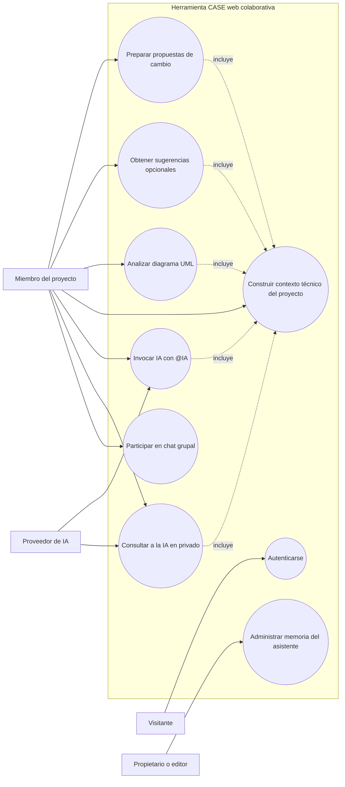

# Casos de uso: ampliación del segundo parcial

## 1. Propósito y relación con el primer parcial

Este documento amplía la especificación del proyecto descrito en el informe del
primer parcial. Conserva como línea base la herramienta CASE web colaborativa,
el modelado UML, la generación de backend Spring Boot, la aplicación móvil
genérica, el trabajo offline, la voz y la IA local. No reemplaza esa línea base:
añade los casos de uso del asistente técnico con IA y del chat de equipo.

La especificación se contrastó con los dos repositorios del proyecto. El estado
indicado distingue las capacidades que se encontraron implementadas de las que
el enunciado nuevo solicita pero el código revisado todavía no ofrece.

## 2. Actores

| Actor | Descripción |
| --- | --- |
| Visitante | Persona que aún no inició sesión. Puede registrarse o autenticarse; no puede acceder al chat del proyecto. |
| Miembro del proyecto | Usuario autenticado con rol `OWNER`, `EDITOR` o `VIEWER`. Puede consultar el chat, su historial y la asistencia de IA del proyecto. |
| Propietario o editor | Miembro con permisos de edición. Además puede crear, modificar y eliminar recuerdos compartidos del proyecto. |
| Integrante autenticado | Usuario que conversa con la IA en privado y administra sus recuerdos privados. |
| Responsable del despliegue | Persona que configura las variables del backend y el proveedor Ollama disponible para el servidor. No existe una pantalla de configuración individual del proveedor. |
| Proveedor de IA | Servicio configurado por el despliegue que genera respuestas. La implementación web revisada utiliza Ollama. |

Un mismo usuario puede ser integrante y propietario/editor según sus permisos.
El `userId`, el autor y el rol se obtienen de la autenticación del servidor; el
cliente no puede atribuir un mensaje a otra persona.

## 3. Modelo de casos de uso

La configuración de modelos y la incorporación de proveedores son requisitos
técnicos transversales; no se representan como casos de uso independientes.

## 4. Inventario y prioridad

| ID | Caso de uso | Prioridad | Estado revisado |
| --- | --- | --- | --- |
| CU-01 | Consultar a la IA como asistente técnico y mentor | Alta | Implementado con Ollama; calidad de respuesta depende del modelo y del contexto disponible. |
| CU-02 | Participar en el chat grupal con autor identificado | Alta | Implementado mediante REST y WebSocket para miembros del proyecto. |
| CU-03 | Invocar a la IA en el chat grupal | Alta | Implementado mediante la mención `@IA`. |
| CU-04 | Consultar la IA en una conversación privada | Alta | Implementado con historial persistente y respuesta de IA. |
| CU-05 | Gestionar memoria técnica del proyecto o privada | Media | Implementado como recuerdos explícitos editables; no es aprendizaje automático autónomo. |
| CU-06 | Analizar un diagrama UML y consultar hallazgos | Alta | Implementado en el editor con resultados estructurados, referencias a elementos y filtro conservador de afirmaciones no verificables. |
| CU-07 | Obtener sugerencias de mejora opcionales | Media | Implementado con un máximo de tres sugerencias revisables; no modifica el diagrama. |
| CU-08 | Preparar propuestas de cambio UML | Alta | Implementado como vista previa editable y descartable; no hay acción para aplicar las propuestas desde este flujo. |

La interpretación de comandos con IA local en la aplicación móvil pertenece a
la línea base del primer parcial y se documenta como capacidad heredada, no como
caso de uso nuevo de esta lista.

## 5. Especificación de casos de uso nuevos

### CU-01. Consultar a la IA como asistente técnico y mentor

**Actor principal:** Integrante autenticado.  
**Objetivo:** Obtener orientación técnica sobre el proyecto, su arquitectura,
UML, generación de código y decisiones de implementación.

**Precondiciones:** El integrante inició sesión y es miembro del proyecto. El
backend y la conversación están disponibles. Para generar una respuesta debe
estar habilitado el orquestador y disponible el proveedor configurado.

**Flujo principal:**

1. El integrante abre el chat del proyecto y elige el ámbito `Diagrama actual`
   o `Proyecto completo`; después usa `Privado con IA` o escribe en el chat
   grupal una pregunta que menciona `@IA`.
2. El sistema valida la pertenencia al proyecto y persiste el mensaje con la
   identidad autenticada del autor.
3. El backend arma el contexto con información persistida: para el ámbito de
   proyecto, un índice acotado de diagramas; para el ámbito de diagrama, el
   diagrama seleccionado. También puede incluir recuerdos autorizados, hasta
   ocho mensajes recientes y referencias UML pertinentes.
4. El orquestador envía contexto y pregunta al proveedor de IA configurado.
5. El sistema persiste la respuesta con autor `SW1 IA`; en una conversación
   grupal, la difunde a los miembros conectados autorizados.
6. El integrante lee la orientación técnica en el historial.

**Alternativas y errores:**

- Si el usuario no es miembro, el backend deniega acceso y no comparte contexto.
- Si el proveedor no está disponible o el orquestador está deshabilitado, el
  chat conserva el mensaje humano y comunica un error controlado de generación.
- Algunas preguntas factuales sobre diagramas, clases, atributos, métodos o
  relaciones se contestan consultando el modelo persistido, sin inferencia del
  LLM.
- Si la pregunta requiere modificar el diagrama, la IA puede explicar una
  solución o preparar propuestas limitadas mediante CU-08, pero no altera
  directamente el modelo canónico.

**Postcondición:** La pregunta y, si se generó, la respuesta quedan asociadas a
la conversación y a sus autores.  
**Reglas:** El servidor obtiene la identidad desde JWT; el contexto procede de
datos persistidos; la IA no recibe herramientas para modificar el diagrama.

### CU-02. Participar en el chat grupal con autor identificado

**Actor principal:** Miembro autenticado del proyecto.  
**Objetivo:** Compartir preguntas y respuestas con el equipo e identificar
quién escribió cada mensaje.

**Precondiciones:** El actor es miembro real del proyecto (`OWNER`, `EDITOR` o
`VIEWER`) y tiene una sesión autenticada.

**Flujo principal:**

1. El miembro abre la conversación del proyecto.
2. El cliente carga el historial paginado y se suscribe a los eventos del
   proyecto por WebSocket.
3. El miembro redacta y envía un mensaje.
4. El servidor valida la conversación, toma la identidad desde la sesión,
   guarda el mensaje y difunde el evento después de persistirlo.
5. Cada miembro conectado ve el contenido, el nombre del autor y la hora.

**Alternativas y errores:** El servidor rechaza usuarios sin membresía,
mensajes inválidos o repetidos; un reintento con el mismo identificador de
cliente no crea una segunda copia del mensaje.

**Postcondición:** El mensaje queda disponible en el historial del proyecto y
para los miembros autorizados conectados.

### CU-03. Invocar a la IA desde el chat grupal

**Actor principal:** Miembro autenticado del proyecto.  
**Objetivo:** Solicitar asistencia en una conversación visible al equipo.

**Precondiciones:** Se cumplen las precondiciones de CU-02 y el orquestador está
habilitado.

**Flujo principal:**

1. El miembro envía un mensaje grupal que contiene `@IA` y su pregunta.
2. El sistema guarda y difunde primero el mensaje humano.
3. El orquestador crea una solicitud de generación con contexto autorizado.
4. La IA genera una respuesta; el backend la guarda con autor `SW1 IA`.
5. El backend difunde la respuesta a los miembros conectados autorizados.

**Alternativa:** Un mensaje grupal sin `@IA` se guarda y difunde como mensaje
normal, sin solicitar una respuesta al modelo.

**Postcondición:** La solicitud y la respuesta (si la generación concluye)
quedan en el historial grupal.

### CU-04. Consultar a la IA en una conversación privada

**Actor principal:** Integrante autenticado.  
**Objetivo:** Pedir orientación a la IA sin difundir la pregunta al grupo.

**Flujo principal:**

1. El actor abre la pestaña privada de IA del proyecto.
2. El sistema devuelve únicamente la conversación privada asociada al usuario.
3. El actor envía una pregunta; el servidor persiste el mensaje y programa la
   generación después de confirmar el guardado.
4. La IA responde usando el contexto autorizado del proyecto y la memoria
   privada y compartida que corresponda.
5. El backend guarda la respuesta y la hace visible solo al propietario de esa
   conversación.

**Postcondición:** El historial privado se conserva y no se difunde por el
canal grupal del proyecto.

### CU-05. Gestionar memoria técnica del asistente

**Actor principal:** Miembro del proyecto; propietario/editor para recuerdos
compartidos.  
**Objetivo:** Conservar decisiones, convenciones, preferencias y notas que
ayuden a contextualizar respuestas futuras.

**Flujo principal:** El actor abre `Administrar memoria`, elige el ámbito
compartido o privado, y crea, consulta, edita o elimina un recuerdo. El sistema
valida permisos, límites de contenido y duplicados, guarda el recuerdo e
incorpora los recuerdos autorizados al contexto de consultas posteriores.

**Reglas:** Los recuerdos privados solo pertenecen a su creador. Los compartidos
requieren rol `OWNER` o `EDITOR` para escritura y se sincronizan con el equipo.
La memoria es explícita y acotada; no aprende automáticamente de toda la
conversación.

### Capacidad heredada del primer parcial: IA local móvil

**Actor principal:** Usuario de la aplicación móvil Flutter.  
**Objetivo:** Ejecutar operaciones CRUD mediante instrucciones escritas o
reconocidas por voz sobre el esquema runtime disponible.

**Flujo principal:** El usuario introduce o dicta un comando; el runtime entrega
al intérprete el esquema de entidades; el modelo local propone una intención
estructurada; el parser valida entidades, campos, tipos e identificadores; y el
ejecutor muestra o realiza la operación conforme a las reglas del runtime.

**Reglas y límites:** El modelo móvil no tiene acceso directo a HTTP, base de
datos ni herramientas. Las operaciones destructivas requieren confirmación.
Ante modelo ausente, error o baja confianza, se utiliza el intérprete
determinista. Esta función es asistencia operativa móvil, no el chat técnico
grupal del proyecto.

### CU-06. Analizar un diagrama UML y consultar hallazgos

**Actor principal:** Miembro autenticado del proyecto.  
**Objetivo:** Recibir una revisión del diagrama sobre estructura, relaciones,
atributos, operaciones, multiplicidades y convenciones de nombres.

**Flujo principal:** El actor abre el panel de IA y elige `Validar`; el sistema
valida el acceso, obtiene el modelo canónico persistido y añade conocimiento
UML pertinente. El modelo produce un resumen y hallazgos estructurados por
severidad, categoría y elemento relacionado. El backend valida la respuesta y
descarta hallazgos que contradicen el modelo o no tienen evidencia aceptable.
El usuario revisa el resultado y puede enfocar un elemento citado en el
diagrama.

**Alternativas:** Si el modelo cambia mientras se analiza, la interfaz marca
el resultado como posiblemente desactualizado. Si el servicio está ocupado o
no disponible, se muestra un error y se permite reintentar.

**Postcondición:** Se muestra una revisión informativa; el modelo no cambia.
La política limita afirmaciones semánticas que no pueden probarse solo con el
diagrama, por lo que el análisis no equivale a una verificación formal completa.

### CU-07. Obtener sugerencias de mejora opcionales

**Actor principal:** Miembro autenticado del proyecto.  
**Objetivo:** Explorar mejoras potenciales sin confundir supuestos de negocio
con hechos del modelo.

**Flujo principal:** El usuario elige `Mejorar`; el sistema arma el contexto
del diagrama, genera hasta tres recomendaciones opcionales, valida categorías
y referencias a elementos existentes, y muestra razón y propuesta. Si una
recomendación depende de reglas del negocio, la interfaz lo indica. El usuario
puede navegar al elemento citado.

**Reglas y postcondición:** Las sugerencias no ejecutan ni persisten cambios.
El alcance implementado prioriza atributos y recomendaciones generales; no
debe inferir que una clase vacía esté incompleta ni proponer relaciones o
métodos sin sustento.

### CU-08. Preparar propuestas de cambio UML

**Actor principal:** Miembro autenticado del proyecto.  
**Objetivo:** Pedir una propuesta explícita, acotada y revisable para modificar
atributos de una clase.

**Flujo principal:** El usuario elige `Cambios`, opcionalmente selecciona una
clase objetivo y escribe una instrucción. El backend verifica proyecto,
diagrama, versión y elementos; genera como máximo tres propuestas para agregar
un atributo, renombrarlo o cambiar su tipo; valida que IDs y valores sean
compatibles. La interfaz muestra la versión consultada y una vista previa que
el usuario puede editar, desmarcar o descartar.

**Alternativas:** Si la instrucción es ambigua, el objetivo no existe o el
diagrama cambió durante la solicitud, se devuelve una vista vacía o marcada
como desactualizada y se puede volver a generar. Las propuestas que requieran
decisión de negocio se identifican explícitamente.

**Postcondición y límite:** Solo se prepara y revisa una vista previa; no se
modifica el diagrama y la interfaz no ofrece una acción de aplicar estas
propuestas. Cualquier edición posterior debe realizarse por las operaciones
normales del editor, que se validan contra el modelo canónico.

## 6. Requisitos del segundo parcial y trazabilidad

| Requisito del docente | Caso(s) relacionado(s) | Estado observado en el código |
| --- | --- | --- |
| Incorporar lo realizado en el primer parcial | Línea base descrita en el informe y README | Separado en los repositorios web CASE y runtime móvil; conservar su trazabilidad en el informe consolidado. |
| Completar funcionalidades y corregir errores | Todos | Trabajo de calidad continuo; esta documentación no certifica que el sistema esté al 100 %. |
| Realizar ajustes necesarios | CU-01 a CU-08 | Se añadieron análisis, sugerencias, propuestas de cambio y contexto seleccionable; evaluar cada cambio con pruebas del proyecto. |
| IA como desarrollador sénior y mentor | CU-01, CU-06, CU-07, CU-08 | Asistente técnico, análisis UML, sugerencias y propuestas acotadas implementados; no modifica código ni el diagrama por sí mismo. |
| Conocer el contexto y responder preguntas técnicas | CU-01, CU-04, CU-06, CU-07, CU-08 | Contexto seleccionable de proyecto o diagrama, historial reciente, memorias autorizadas y referencias UML implementados; preguntas factuales soportadas consultan datos persistidos. |
| Orientar a integrantes del equipo | CU-01, CU-03, CU-06, CU-07, CU-08 | Disponible en chat privado, por `@IA` y en herramientas de análisis, sugerencias y propuestas. |
| Chat grupal con autor identificable | CU-02 | Implementado; nombre del autor se muestra y la identidad la determina el servidor. |
| Modelo configurable y opción local | Requisito técnico transversal | IA local implementada en Flutter para comandos; Ollama se configura por entorno para el chat web. No hay selector unificado en el chat web. |
| Modelos externos, por ejemplo servicio compatible con Colab | Requisito técnico transversal | Pendiente en el chat web revisado. |
| Respuestas completas y soluciones técnicas útiles | CU-01, CU-06, CU-07, CU-08 | Se añadieron consultas factuales, análisis con filtro de evidencia, sugerencias y propuestas para atributos. No cubren todas las solicitudes de desarrollo; la utilidad depende del modelo y debe evaluarse con escenarios acordados. |

## 7. Reglas transversales y restricciones

1. La autenticación y la membresía del proyecto se validan antes de leer
   conversaciones, memoria o contexto.
2. El servidor obtiene autor y rol de la sesión autenticada, no de los datos
   enviados por el cliente.
3. Los datos del proyecto y del modelo UML se consultan desde PostgreSQL. El
   cliente no es fuente de verdad para el contexto del asistente.
4. La IA puede orientar, explicar y proponer. Toda modificación UML debe pasar
   por operaciones semánticas validadas contra el modelo canónico.
5. Las conversaciones humanas siguen disponibles aunque el proveedor de IA no
   responda.
6. Las credenciales de proveedores externos deben residir en configuración
   segura del servidor y nunca en el repositorio o el frontend.

## 8. Referencias de implementación

- Chat y orquestación web: `docs/ai-chat-phase1.md`,
  `docs/ai-chat-phase2.md` y `docs/ai-chat-phase3.md`.
- API de las funciones nuevas:
  - `POST /api/projects/{projectId}/ai/analyze?diagramId={diagramId}`
  - `POST /api/projects/{projectId}/ai/suggestions?diagramId={diagramId}`
  - `POST /api/projects/{projectId}/ai/change-proposals?diagramId={diagramId}`
- Contexto y respuestas factuales: `AiContextService` y
  `AiFactualQueryService` en `backend/src/main/java/com/sw1/umltool/features/ai/chat/service/`.
- Análisis, sugerencias y propuestas: paquetes `analysis`, `suggestions` y
  `changeproposal` bajo `backend/src/main/java/com/sw1/umltool/features/ai/`.
- Arquitectura general: `docs/architecture.md`.
- Interpretación móvil local: `../../sw1-uml-mobile-runtime/sw1_uml_mobile_runtime/docs/local_llm.md`.
- Voz offline móvil: `../../sw1-uml-mobile-runtime/sw1_uml_mobile_runtime/docs/offline_speech.md`.
- Informe de base del primer parcial: archivo PDF entregado por el equipo.
